# Compose Village

A cozy desktop game for learning Jetpack Compose. The villagers of Main Street each ask for a sign for their shop. You write real Kotlin + Compose code. The game compiles it inside the app, shows your screen in a preview, and checks it against the villager's wishes. Finish a level and their shop lights up on the street.

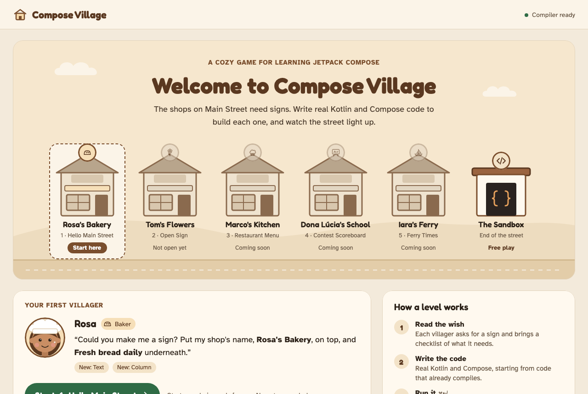

## Main Street

The game opens on Main Street. Each building is a level; the Sandbox is at the end of the street. Its five villagers ask for a little more each time:

| | Level | Villager | New ideas |
|---|---|---|---|
| 1 | Hello Main Street | Rosa, the baker | `Text`, `Column` |
| 2 | Open Sign | Tom, the florist | `Row`, `Button`, `onClick` |
| 3 | Restaurant Menu | Marco, the chef | lists and `forEach` |
| 4 | Contest Scoreboard | Dona Lúcia, the teacher | `remember`, `mutableStateOf` |
| 5 | Ferry Times | Iara, the boat captain | `TextField`, `filter`, `if` |

 When you come back, the street shows the shops you've opened and who is still waiting, and **Continue** picks up where you left off. "Main Street" in a level's header takes you back.

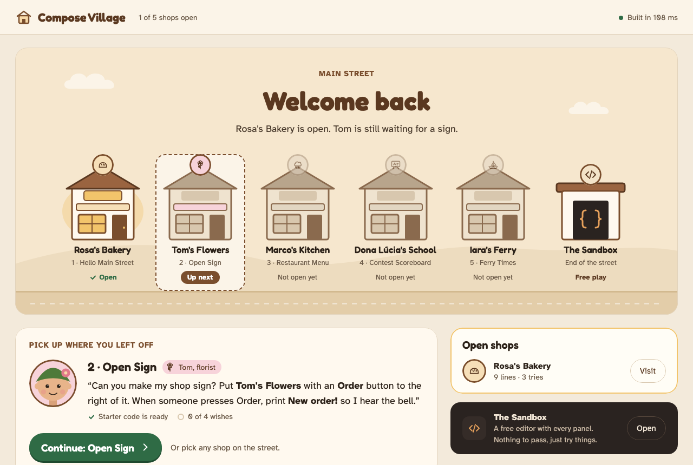

## How a level plays

Every level is a villager with a request, starter code and a checklist.

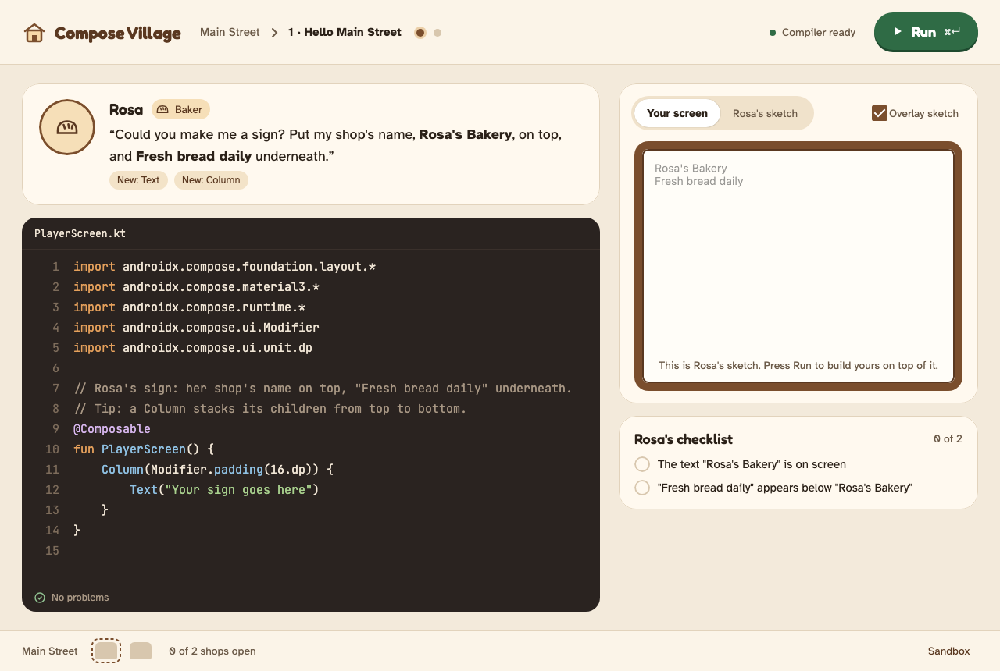

| | |
|---|---|
| 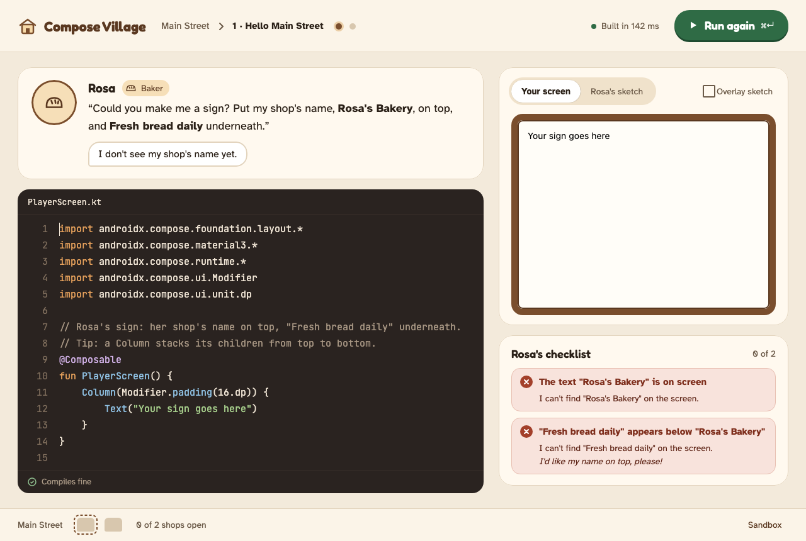 | 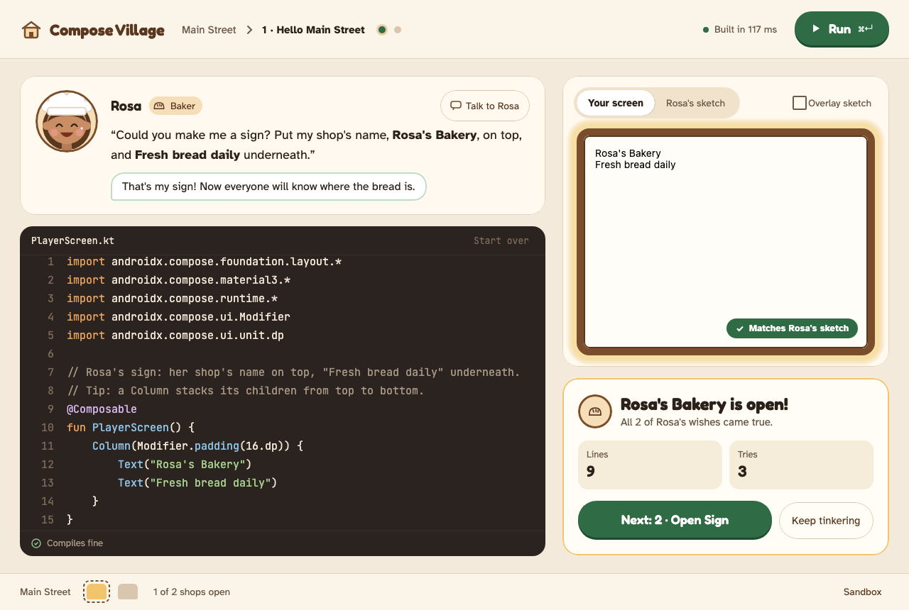 |
| **Run** (⌘↵) compiles your code. Each wish on the checklist is then ticked or explained, and the villager reacts. | When every wish comes true, the sign glows, the shop opens and the next villager is waiting. |
| 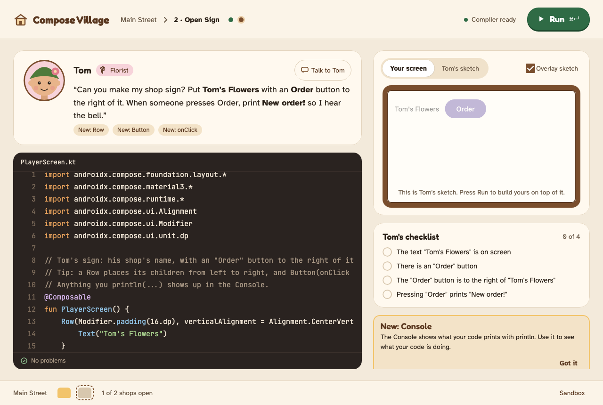 | 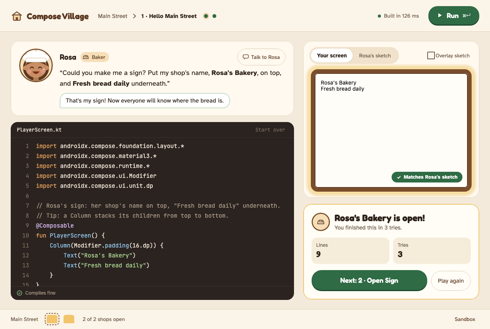 |
| New tools, like the Console, unlock when a level first needs them. | Progress is saved. A finished level reopens with your code and your sign, and you can play it again. |
| 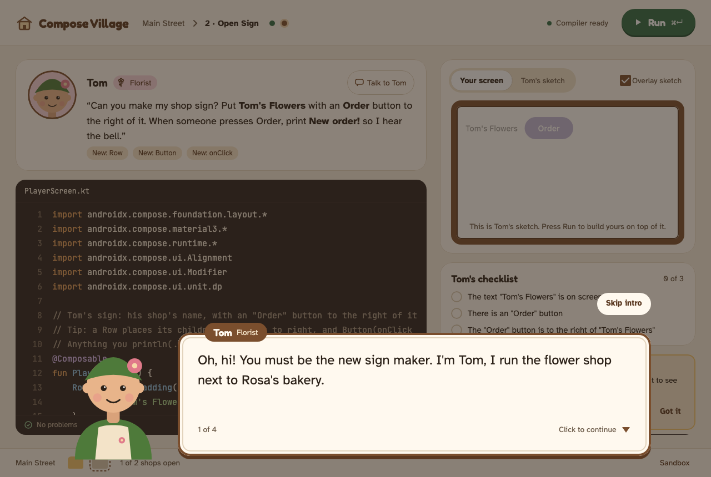 | 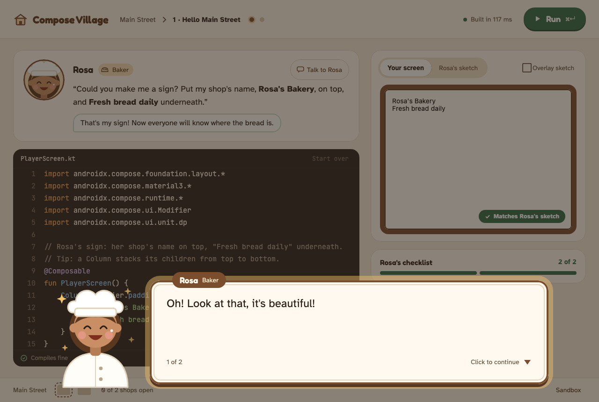 |
| Villagers talk. The first time a level opens, its villager introduces themselves and their wish; **Talk to** replays it. | When their shop first opens, they celebrate before the completion card appears. |

Some wishes are about what a button *does*. After each Run, a customer uses your screen, for example pressing Tom's Order button, and the Console and the checklist show what happened:

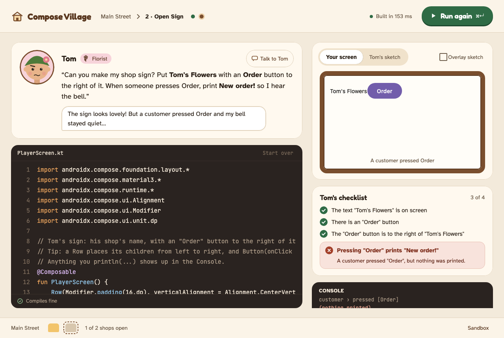

Later villagers ask for screens that remember things. Dona Lúcia's customer presses her scoreboard's buttons four times in a row, and Iara's types two searches into her timetable. When a press changes nothing, the checklist says so:

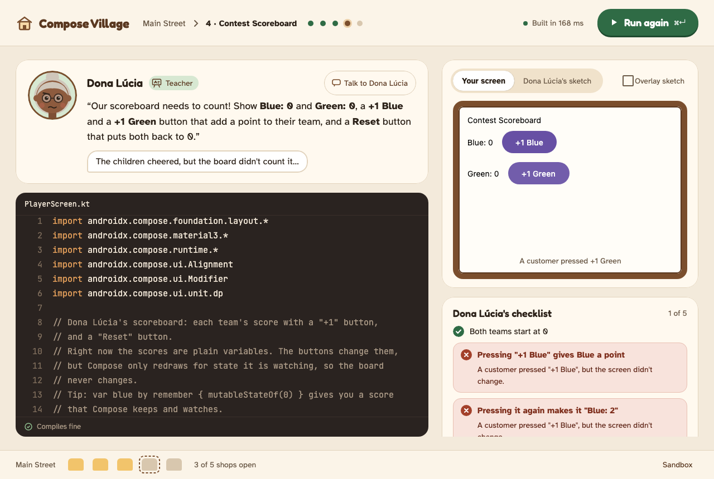

The **Sandbox**, at the end of the street, is a free editor with every panel. Compile errors, sandbox violations and runtime crashes point at the line that caused them:

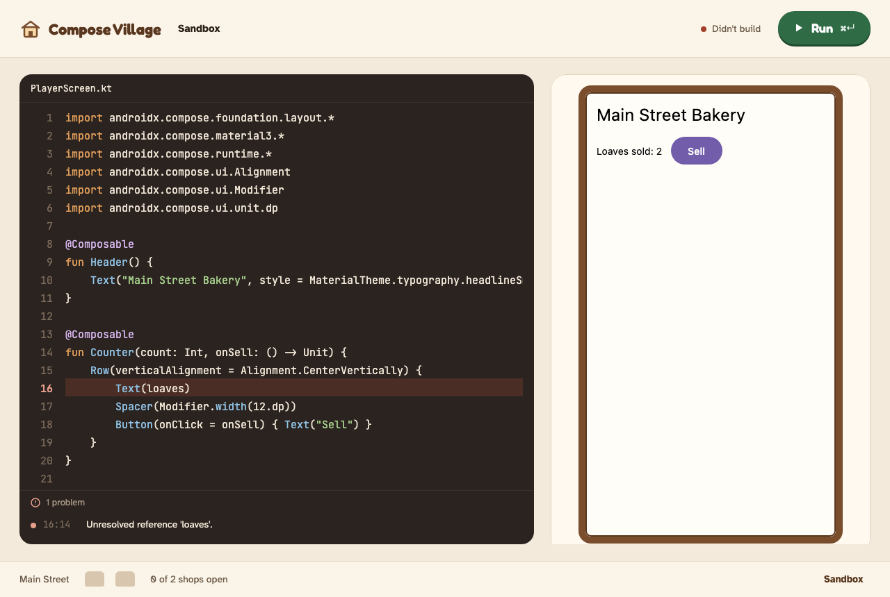

## Running it

You need JDK 17 (Gradle downloads one through toolchains if it can't find it).

```sh
./gradlew :app:run            # play
./gradlew build               # compile and run every test, including the self-checking levels
./gradlew :app:packageDmg     # macOS installer → app/build/compose/binaries/main/dmg/
```

Options:
- **Self-test:** a packaged app run with `--selftest` compiles and runs a sample player program, then prints `OK`.
- **`-Dvillage.reducedMotion=true`:** turns animations off. Otherwise the game follows the macOS *Reduce motion* setting.
- **`-Dvillage.progress=<file>`:** saves progress somewhere other than `~/Library/Application Support/Compose Village/progress.json`. That default is for macOS; Windows uses `%APPDATA%`, Linux `$XDG_DATA_HOME`.

The window check (`./gradlew :app:spike -Pargs="--only window"`) plays the whole street offscreen. It saves a screenshot of every state to `app/build/spike/window/`; the images above come from it. It also takes:
- `--baseline <dir>`: copies the screenshots to `<dir>`.
- `--compare <dir>`: reports, for each state, how many pixels differ from the screenshots in `<dir>` and where, and writes diff images to `app/build/spike/window-diff/`. Use this to check that a refactor left the screens unchanged. Between two runs of the same code, only the build time and a few anti-aliased editor and bust edges differ.
- `--theme tracer`: draws every state with the tracer theme, a loud, dark, square theme that is never shown to players. A surface that still looks cozy in `app/build/spike/window-tracer/` doesn't follow the theme yet.

## How it works

Player code runs **inside the game's own JVM**:
1. The embedded Kotlin compiler and the Compose compiler plugin compile your code.
2. An ASM bytecode guard checks it.
3. It loads in its own class loader.
4. It renders in an offscreen Compose scene on a dedicated thread.

The spike that chose this design, with its measurements, is in [`docs/spike/report.md`](docs/spike/report.md).

| Module | What it does |
|---|---|
| `host-api` | Types shared by the game and the player's code, which run in separate class loaders |
| `compiler` | The player-code pipeline: embedded `kotlinc` + Compose plugin, bytecode guard, class loading |
| `preview` | Hosts the player's composable in an isolated, offscreen scene and takes semantics snapshots |
| `levels` | Level data, the strict JSON loader and the acceptance evaluator. Each level's target image is rendered from its reference solution at build time |
| `app` | The game window: level screen, theme, saved progress, and the spike/check harness |

Levels live in [`levels/src/main/resources/levels/`](levels/src/main/resources/levels), one folder per level with a `level.json`. A level holds:
- the villager and their request;
- the starter code;
- the panels it uses;
- what a customer does after the first frame, such as pressing a button or typing into a field;
- its criteria, such as "this text exists", "this button is to the right of that text" or "pressing Order prints New order!". An `all` criterion groups several checks into one checklist row, such as "every dish is on the menu".

Each level's reference solution sits in `levels/src/test/resources/levels/`. The build checks that the solution passes every criterion, and that the starter code compiles but doesn't pass yet.

## Project docs

- [`openspec/`](openspec): specs and change history. The project is planned with [OpenSpec](https://github.com/Fission-AI/OpenSpec):
  - `specs/` describes how the game behaves now;
  - `changes/` holds work in progress and the roadmap;
  - `changes/archive/` holds finished changes.
- [`design-docs/cozy/`](design-docs/cozy): the visual design, with tokens, mockups, the motion storyboard and villager icons.

## Credits

The fonts are [Fredoka](https://fonts.google.com/specimen/Fredoka), [Atkinson Hyperlegible](https://fonts.google.com/specimen/Atkinson+Hyperlegible) and [JetBrains Mono](https://www.jetbrains.com/lp/mono/). All three are under the SIL Open Font License ([`OFL.txt`](app/src/main/resources/font/OFL.txt)).
